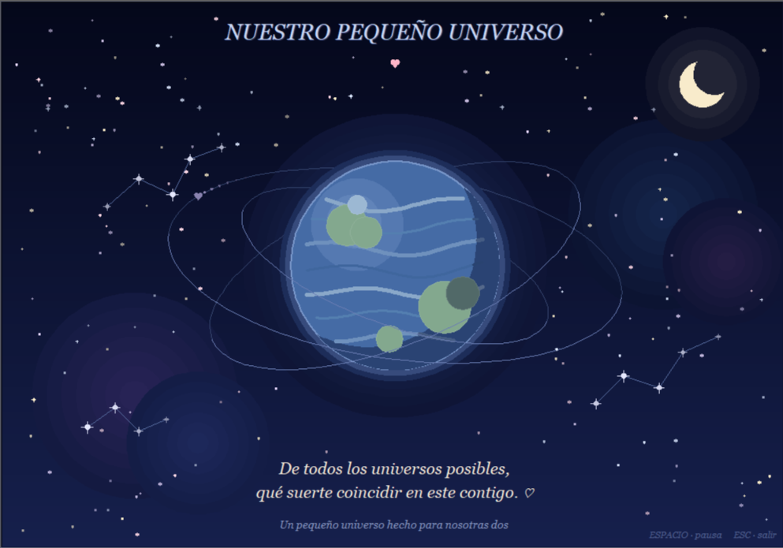

# Our Little Universe ♡

A little universe made of stars, dreams, and tiny hearts orbiting around a planet. A Python Turtle animation featuring a slowly rotating world, floating hearts, distant constellations, and a beautiful night sky.

Created with love as a small reminder that, among all the universes that could have existed, we were lucky enough to meet in this one.

## Preview

<p align="center">
  
</p>

<p align="center">
  <a href="graphical-representation/universe.mp4">▶ Watch the animation</a>
</p>

## Features

- **Animated Planet:** A blue planet with green continents, curved ocean bands, atmospheric glow, and realistic lighting effects.
- **Planetary Rotation:** Surface details move gradually to create the illusion of a rotating world.
- **Orbiting Hearts:** Three small hearts travel around the planet along elliptical orbits, each with its own direction, speed, and size.
- **Orbital Trails:** Subtle trails and depth effects make the hearts appear to move behind and in front of the planet.
- **Starry Background:** A deep blue gradient sky filled with randomly positioned stars.
- **Nebula Effects:** Soft purple and blue nebula-like formations add depth to the background.
- **Twinkling Stars:** Small stars continuously change their brightness, creating a living night sky.
- **Constellations:** Groups of connected stars decorate the space around the planet.
- **Crescent Moon:** A glowing crescent moon completes the celestial atmosphere.
- **Shooting Stars:** Occasional shooting stars cross the sky with a fading trail.
- **Romantic Dedication:** A personal message appears beneath the animated universe.

## The Message

The animation includes the following dedication:

> De todos los universos posibles,  
> qué suerte coincidir en este contigo. ♡

## Technologies Used

- Python 3
- Turtle Graphics
- Tkinter
- Math
- Random
- Time

The project uses Python's standard libraries and does not require third-party packages.

## Getting Started

### Requirements

- Python 3.x
- Tkinter installed and enabled
- A graphical desktop environment

### Installation

Clone the repository:

```bash
git clone https://github.com/laetg404/our-little-universe.git
```

Navigate to the project directory:

```bash
cd our-little-universe
```

Run the animation:

```bash
python main.py
```

## Controls

| Key | Action |
|---|---|
| `SPACE` | Pause or resume the animation |
| `ESC` | Close the application |

## Animation Details

The animation combines several elements to create a small celestial scene:

1. A deep blue gradient sky appears, filled with stars and colorful nebulae.
2. A crescent moon illuminates the upper-right corner.
3. A blue planet emerges in the center, with moving ocean bands, drifting continents, and a softly illuminated atmosphere.
4. Three little hearts begin orbiting the planet along separate elliptical paths.
5. Their movement includes depth effects, making some hearts pass behind the planet while others appear in front.
6. Constellations twinkle in the distance, while occasional shooting stars cross the sky.

The animation runs continuously, creating a peaceful little universe.

## Project Structure

```text
our-little-universe/
│
├── graphical-representation/
│   ├── universe.png
│   └── universe.mp4
│
├── main.py
└── README.md
```

### Graphical Representation

The `graphical-representation` folder contains visual previews of the project:

- `universe.png` — A screenshot showcasing the animated planet, orbiting hearts, and celestial background.
- `universe.mp4` — A video recording of the animation, showing the planet's movement, orbiting hearts, twinkling constellations, and shooting stars.

These files provide a visual reference of the project without having to run the Python script.

## A Little Dedication ♡

My love,

Out of all the stars, all the galaxies, and all the universes that could have existed, somehow our paths crossed.

I don't know how many universes there are or what they might look like, but I know that in this one, I found someone who makes everything feel a little more special.

And if I could choose again, in every possible universe, I'd still hope to find my way to you.

**You are my favorite little universe. ♡**

---

<sub>Part of a collection of little projects created with love.</sub>

⭐ 🪐
